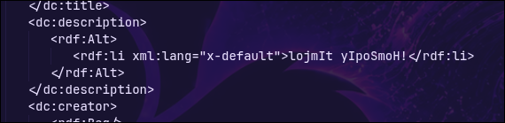

# Diagraphephobia

| **CTF**        | SpookyCTF |
| -------------- | --------- |
| **Categoría**  | Crypto    |
| **Puntos**     | 75        |
| **Dificultad** | Easy      |

## Enunciado

The Federation has found a redacted file from spying on the Klingon. They want to know the contents of it. Can you find it?
## Resumen

El reto da un PDF (`Diagraphephobia.pdf`) con un título corto (`Ja'`), una imagen con ruido y un párrafo oculto bajo barras negras.

## Solución

### Las barras negras no ocultan nada

La "censura" son solo cajas negras dibujadas encima del texto, pero el texto sigue dentro del PDF. Se puede extraer con `pdftotext`, o simplemente seleccionándolo con el ratón en un visor de PDF:

```bash
pdftotext Diagraphephobia.pdf -
```

```
Ja'
B7o731QSZYJtbxIHjz045jhZoAhjG/MHqir4PZANSCWd75Jp/KGdAevRj2JOBEN3eME
W9Sto9ek0bGum9jXYPHiQ/3xQM8ZTrrB6a2OZJNAYCgFizrrNO4enzaXB2ZAGdN+fB
KQPPe530ZxrXlWBTV2QCyqJH8BmHGXKMU3XASpqaWeTXZzvhx1FJOkhV2pw2bif
mMo0Pk4i3XznS1UYsQ==
```

Parece base64 (letras, dígitos, `+`, `/` y `==` al final). El texto sale partido en varias líneas, así que antes de usarlo hay que unirlas **sin espacios**. Se decodifica a 160 bytes que no son texto legible, así que está cifrado. 160 es múltiplo de 16, lo que apunta a un cifrado por bloques como AES.

### Mirar los metadatos

El enunciado habla de un "archivo", y lo único que tiene un PDF aparte de su contenido son los metadatos:

```bash
pdfinfo -meta Diagraphephobia.pdf
```

El campo de descripción tiene un texto corto:

```xml
<dc:description>
   <rdf:Alt>
      <rdf:li xml:lang="x-default">lojmIt yIpoSmoH!</rdf:li>
   </rdf:Alt>
</dc:description>
```



Es klingon (el enunciado menciona a los klingon) y significa **"¡Abre la puerta!"** (*Open the door!*). Una frase sobre abrir algo junto a un texto cifrado parece una clave. Además mide exactamente **16 bytes**, el tamaño de una clave AES-128.

### Descifrar

No se sabe el modo de operación, así que probé los habituales (ECB, CBC...) con esa frase como clave. Funciona con **AES-128 en modo ECB**, sin IV y sin derivar la clave, usando la frase tal cual:

```bash
echo 'B7o731QSZYJtbxIHjz045jhZoAhjG/MHqir4PZANSCWd75Jp/KGdAevRj2JOBEN3eMEW9Sto9ek0bGum9jXYPHiQ/3xQM8ZTrrB6a2OZJNAYCgFizrrNO4enzaXB2ZAGdN+fBKQPPe530ZxrXlWBTV2QCyqJH8BmHGXKMU3XASpqaWeTXZzvhx1FJOkhV2pw2bifmMo0Pk4i3XznS1UYsQ==' \
  | base64 -d \
  | openssl enc -d -aes-128-ecb -K "$(printf '%s' 'lojmIt yIpoSmoH!' | xxd -p)"
```

Lo mismo se puede hacer en CyberChef con `From Base64` seguido de `AES Decrypt` (clave `lojmIt yIpoSmoH!` como UTF8, IV vacío, modo `ECB`, entrada y salida `Raw`).

El resultado es un texto en klingon:

```
nuqneH
DaHjaj tlhIngan yotlh botlhDaq DIvI' Duj wItu'. Heghlaw' 'ej lonlu'law'. Duj wIHuD 'ej Hov leng peghmey wItu'laH 'e' wItlhoblI'.

spooky{qaStaH_nuq}
```

Empieza por `nuqneH`, el saludo habitual en klingon ("¿Qué quieres?"), y la última línea es la flag. `qaStaH nuq` es el klingon de "¿Qué está pasando?".

## Flag

```
spooky{qaStaH_nuq}
```

## Lo aprendido

- Tapar texto con cajas negras no es censurar: el texto sigue en el archivo. Una censura de verdad tiene que eliminarlo.
- Los metadatos de un PDF pueden esconder datos. Merece la pena mirarlos con `pdfinfo -meta` o `exiftool`.
- Una clave de exactamente 16 bytes sugiere AES-128. Si no se sabe el modo, se prueban los sencillos (ECB, CBC) uno a uno.
- El idioma de una pista dice qué hacer con ella: una frase en klingon que significa "¡Abre la puerta!" era la clave para abrir el mensaje.