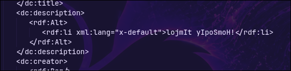

# Diagraphephobia

| **CTF**        | SpookyCTF |
| -------------- | --------- |
| **Category**   | Crypto    |
| **Points**     | 75        |
| **Difficulty** | Easy      |

## Statement

The Federation has found a redacted file from spying on the Klingon. They want to know the contents of it. Can you find it?

## Overview

The challenge gives a PDF (`Diagraphephobia.pdf`) with a short title (`Ja'`), a noisy image and a paragraph hidden under black bars.

## Solution

### The black bars hide nothing

The "redaction" is just black boxes drawn over the text, but the text is still inside the PDF. It can be extracted with `pdftotext`, or just selecting it with the mouse in a PDF viewer:

```bash
pdftotext Diagraphephobia.pdf -
```

```
Ja'
B7o731QSZYJtbxIHjz045jhZoAhjG/MHqir4PZANSCWd75Jp/KGdAevRj2JOBEN3eME
W9Sto9ek0bGum9jXYPHiQ/3xQM8ZTrrB6a2OZJNAYCgFizrrNO4enzaXB2ZAGdN+fB
KQPPe530ZxrXlWBTV2QCyqJH8BmHGXKMU3XASpqaWeTXZzvhx1FJOkhV2pw2bif
mMo0Pk4i3XznS1UYsQ==
```

It looks like base64 (letters, digits, `+`, `/` and `==` at the end). The text is split in several lines, so before using it the lines have to be joined **without spaces**. It decodes to 160 bytes that are not readable text, so it is encrypted. 160 is a multiple of 16, which points to a block cipher such as AES.

### Look at the metadata

The statement talks about a "file", and the only other thing in a PDF is its metadata:

```bash
pdfinfo -meta Diagraphephobia.pdf
```

The description field has a short text:

```xml
<dc:description>
   <rdf:Alt>
      <rdf:li xml:lang="x-default">lojmIt yIpoSmoH!</rdf:li>
   </rdf:Alt>
</dc:description>
```



It is Klingon (the statement mentions the Klingon) and it means **"Open the door!"**. A phrase about opening something next to an encrypted text looks like a key. It also has exactly **16 bytes**, the size of an AES-128 key.

### Decrypt

The mode of operation is unknown, so I tried the usual ones (ECB, CBC...) with that phrase as the key. It works with **AES-128 in ECB mode**, with no IV and no key derivation, using the phrase as it is:

```bash
echo 'B7o731QSZYJtbxIHjz045jhZoAhjG/MHqir4PZANSCWd75Jp/KGdAevRj2JOBEN3eMEW9Sto9ek0bGum9jXYPHiQ/3xQM8ZTrrB6a2OZJNAYCgFizrrNO4enzaXB2ZAGdN+fBKQPPe530ZxrXlWBTV2QCyqJH8BmHGXKMU3XASpqaWeTXZzvhx1FJOkhV2pw2bifmMo0Pk4i3XznS1UYsQ==' \
  | base64 -d \
  | openssl enc -d -aes-128-ecb -K "$(printf '%s' 'lojmIt yIpoSmoH!' | xxd -p)"
```

The same can be done in CyberChef with `From Base64` followed by `AES Decrypt` (key `lojmIt yIpoSmoH!` as UTF8, empty IV, mode `ECB`, input and output `Raw`).

The result is a text in Klingon:

```
nuqneH
DaHjaj tlhIngan yotlh botlhDaq DIvI' Duj wItu'. Heghlaw' 'ej lonlu'law'. Duj wIHuD 'ej Hov leng peghmey wItu'laH 'e' wItlhoblI'.

spooky{qaStaH_nuq}
```

It starts with `nuqneH`, the usual Klingon greeting ("What do you want?"), and the last line is the flag. `qaStaH nuq` is the Klingon for "What's happening?".

## Flag

```
spooky{qaStaH_nuq}
```

## What I learned

- Covering text with black boxes is not a redaction: the text is still in the file. A real redaction has to remove it.
- The metadata of a PDF can hide data. It is worth checking it with `pdfinfo -meta` or `exiftool`.
- A key of exactly 16 bytes suggests AES-128. If the mode is unknown, the simple ones (ECB, CBC) are tried one by one.
- The language of a clue tells what to do with it: a Klingon phrase meaning "Open the door!" was the key to open the message.