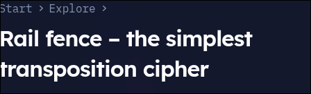
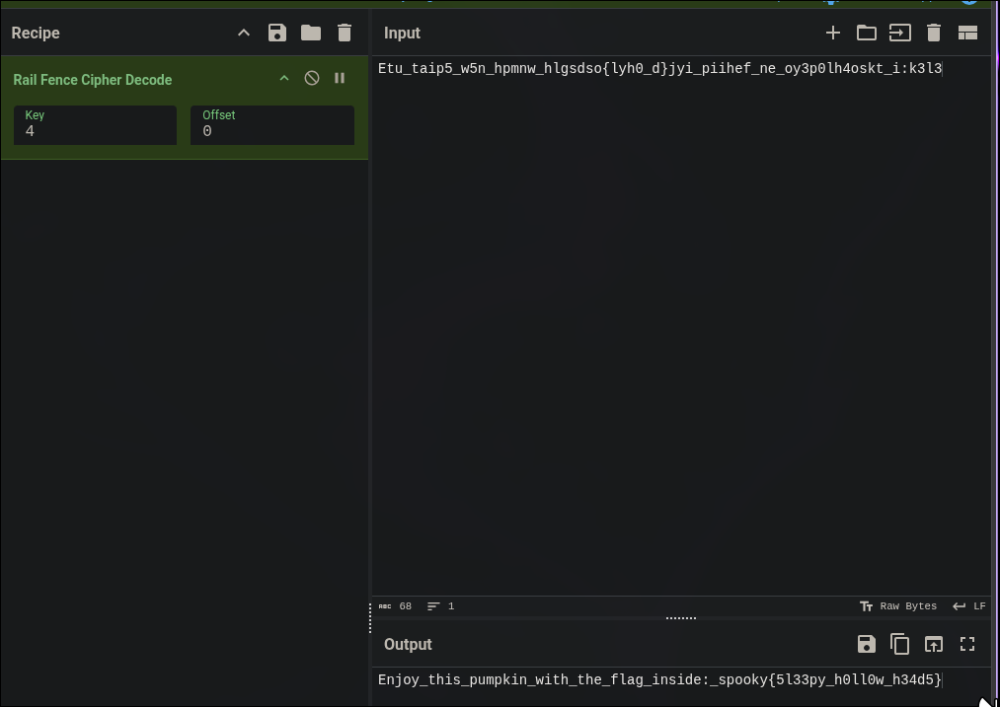

# Heads will Roll

| **CTF**        | SpookyCTF |
| -------------- | --------- |
| **Categoría**  | Crypto    |
| **Puntos**     | 50        |
| **Dificultad** | Easy      |

## Enunciado

Mientras perseguía a Ichabod Crane por Sleepy Hollow, el Jinete sin Cabeza se acercó todo lo que pudo y entonces ¡lanzó su cabeza! Mientras rodaba, rodaba, rodaba, rodaba por el aire, su cabeza de calabaza gritó… ¿el qué? Su puntería perfecta tiró a Ichabod al suelo cerca de los raíles (*rails*), pero ¿qué dijo?

```
Etu_taip5_w5n_hpmnw_hlgsdso{lyh0_d}jyi_piihef_ne_oy3p0lh4oskt_i:k3l3
```

## Resumen

El reto solo da una cadena de 68 caracteres. Parece un texto desordenado: tiene letras, números, guiones bajos e incluso las llaves de una flag, pero en el orden equivocado.

## Solución

### Identificar el cifrado

Dos cosas apuntan a un cifrado de transposición y, más concretamente, al **cifrado Rail Fence**:

- Están todos los caracteres del formato de la flag (`{`, `}`, `_`, dígitos), solo que en otro sitio. Una transposición cambia la posición de los caracteres, pero no los caracteres.
- El enunciado habla de "los raíles" (*rails*: "tiró a Ichabod al suelo cerca de los raíles"), y la cabeza que rueda por el aire de arriba abajo recuerda al zigzag del cifrado.



### Descifrarlo

En CyberChef usé `Rail Fence Cipher Decode`. No se conoce la clave (número de raíles), así que probé valores hasta que el resultado fue legible. Con **clave 4 y offset 0** el texto tiene sentido:



```
Enjoy_this_pumpkin_with_the_flag_inside:_spooky{5l33py_h0ll0w_h34d5}
```

Con otras claves (2, 3, 5, 6, 7) el resultado sigue desordenado.

## Flag

```
spooky{5l33py_h0ll0w_h34d5}
```

## Lo aprendido

- Si un texto cifrado conserva los mismos caracteres que un texto normal (dígitos, símbolos y las llaves de la flag), probablemente es una transposición y no una sustitución.
- Rail Fence tiene pocas claves posibles, así que probarlas una a una en CyberChef basta.
- El enunciado de un reto de crypto suele esconder el nombre del cifrado ("rails").