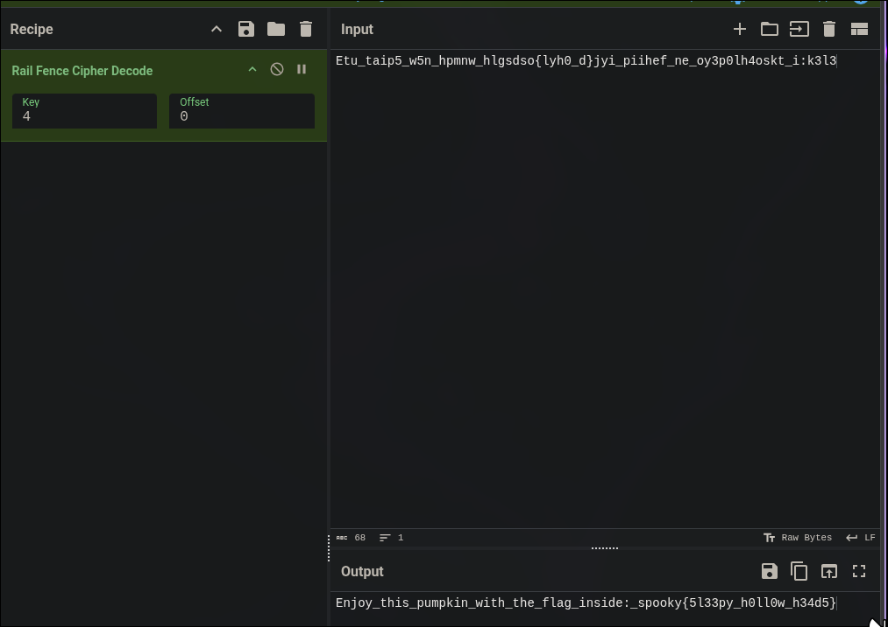

# Heads will Roll

| **CTF**        | SpookyCTF |
| -------------- | --------- |
| **Category**   | Crypto    |
| **Points**     | 50        |
| **Difficulty** | Easy      |

## Statement

While chasing Ichabod Crane through Sleepy Hollow, the Headless Horseman got as close as he could, then threw his head! While rolling, rolling, rolling, rolling, through the air, his pumpkin head shouted…what? His perfect aim knocked Ichabod to the ground near the rails, but what did he say?

```
Etu_taip5_w5n_hpmnw_hlgsdso{lyh0_d}jyi_piihef_ne_oy3p0lh4oskt_i:k3l3
```

## Overview

The challenge only gives a string of 68 characters. It looks like scrambled text: it has letters, numbers, underscores and even the braces of a flag, but in the wrong order.

## Solution

### Identify the cipher

Two things point to a transposition cipher and, more precisely, to the **Rail Fence cipher**:

- The characters of the flag format are all there (`{`, `}`, `_`, digits), only in the wrong place. A transposition changes the position of the characters but not the characters themselves.
- The statement mentions "the rails" ("knocked Ichabod to the ground near the rails"), and the head that rolls up and down through the air recalls the zigzag pattern of the cipher.


### Decode it

In CyberChef I used `Rail Fence Cipher Decode`. The key (number of rails) is unknown, so I tried values until the output was readable. With **key 4 and offset 0** the text makes sense:



```
Enjoy_this_pumpkin_with_the_flag_inside:_spooky{5l33py_h0ll0w_h34d5}
```

With other keys (2, 3, 5, 6, 7) the output is still scrambled.

## Flag

```
spooky{5l33py_h0ll0w_h34d5}
```

## What I learned

- If a ciphertext keeps the same characters as a plain text (digits, symbols and the braces of the flag), it is probably a transposition and not a substitution.
- Rail Fence has few possible keys, so trying them one by one in CyberChef is enough.
- The statement of a crypto challenge usually hides the name of the cipher ("rails").