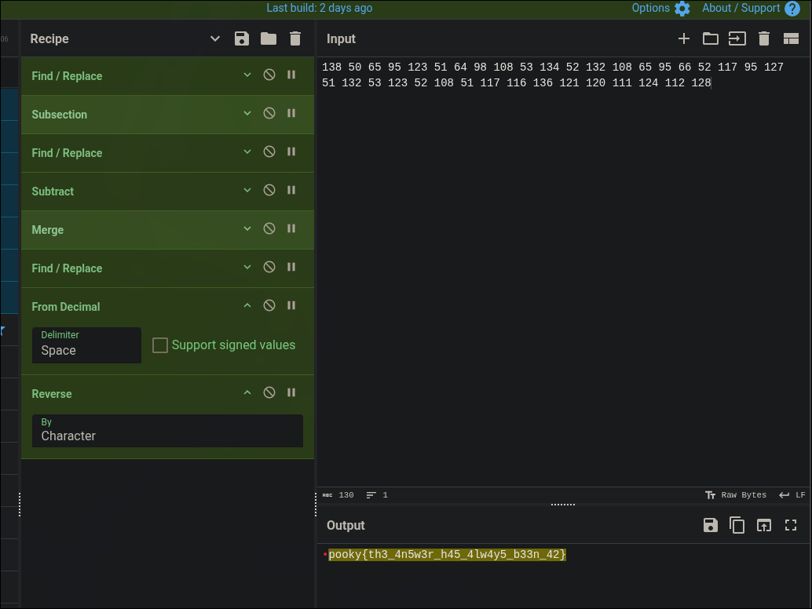

# Numerophobia

| **CTF**        | SpookyCTF |
| -------------- | --------- |
| **Categoría**  | Crypto    |
| **Puntos**     | 50        |
| **Dificultad** | Easy      |

## Enunciado

Fui a explorar la casa del viejo loco de la esquina de la calle. Desapareció el fin de semana pasado y nadie lo ha vuelto a ver. Se rumorea que lo vieron por última vez salir a medianoche gritando números aleatorios en lenguas que nunca se habían hablado. Decidí ir a investigar y, como era de esperar, la puerta principal estaba abierta. De camino a las escaleras casi tropiezo con una pila de libros, uno era sobre la dislexia, creo. Por alguna razón faltaba un escalón de cada dos, y en la pared estaban marcados con un 13. Por fin llegué arriba y me dirigí hacia la luz del final del pasillo. Pegado a la pared había un papel…

```
23 50 65 50 65 50 65 50 65 50 65 50 65 50 65 50 65 50 65 50 65 50 65 50 65 50 65 50 65 50 65 50 65 50 65 50 65 50 65 10 138 50 65 95 123 51 64 98 108 53 134 52 132 108 65 95 66 52 117 95 127 51 132 53 123 52 108 51 117 116 136 121 120 111 124 112 128 10 63 52 63 52 63 52 63 52 63 52 63 52 63 52 63 52 63 52 63 52 63 52 63 52 63 52 63 52 63 52 63 52 63 52 63 52
```

## Resumen

El reto solo da una lista larga de números. El número `10` aparece dos veces y la divide en tres bloques: el primero y el último están hechos de un par de números repetido, y el del medio lleva el mensaje.

## Solución

### Leer las pistas del enunciado

Casi cada frase de la historia describe un paso de la codificación:

| Frase                                                          | Significado                                              |
| -------------------------------------------------------------- | -------------------------------------------------------- |
| "gritando números aleatorios"                                  | Los datos son números decimales (códigos ASCII)          |
| "uno era sobre la dislexia"                                    | El texto está escrito al revés, así que hay que invertirlo |
| "faltaba un escalón de cada dos, marcados con un 13"           | Uno de cada dos números está desplazado 13               |

### Quitar el relleno

El primer bloque es `23` seguido de `50 65` repetido, y el último es `63 52` repetido. Son solo relleno, así que el mensaje es el bloque del medio (entre los dos `10`):

```
138 50 65 95 123 51 64 98 108 53 134 52 132 108 65 95 66 52 117 95 127 51 132 53 123 52 108 51 117 116 136 121 120 111 124 112 128
```

### Deshacer la codificación

Siguiendo las pistas, a uno de cada dos números (el 1.º, 3.º, 5.º...) se le resta 13, se convierte a ASCII y se invierte el resultado. Con los primeros números:

| Número | Tras restar 13 (uno de cada dos) | ASCII |
| ------ | -------------------------------- | ----- |
| 138    | 125                              | `}`   |
| 50     | 50                               | `2`   |
| 65     | 52                               | `4`   |
| 95     | 95                               | `_`   |
| 123    | 110                              | `n`   |

Empieza por `}24_n`, que es el final de una flag leída al revés.

### Receta de CyberChef

CyberChef no tiene una operación para cambiar solo uno de cada dos números, así que monté una receta para ello:



Las operaciones, con los valores que usé:

1. `Find / Replace`: buscar `$`, reemplazar por `0` (regex, global, multilínea).
2. `Subsection`: sección `(\d+) \d+` (distingue mayúsculas, global).
3. `Find / Replace`: buscar `^(\d+)$`, reemplazar por `$1,13` (regex, global, multilínea).
4. `Subtract`: delimitador `Comma`.
5. `Merge`: merge all.
6. `Find / Replace`: buscar `0$`, reemplazar por nada.
7. `From Decimal`: delimitador `Space`.
8. `Reverse`: por `Character`.

Los pasos 2 a 5 restan 13 a uno de cada dos números, el paso 7 convierte los números en caracteres y el paso 8 invierte el texto.

### Arreglar el primer carácter

La salida de la receta es:

```
•pooky{th3_4n5w3r_h45_4lw4y5_b33n_42}
```

El primer carácter sale como un punto rojo, un carácter no imprimible, y falta la `s`. Es el último número (`128`), que la receta no modifica, así que se convierte en el carácter 128 y no en `s`. Aplicando la misma regla a mano, `128 - 13 = 115`, que es `s`.

Como curiosidad, la regla también funciona sobre el texto entero sin quitar el relleno: el primer y el último bloque se decodifican como `2424...`, que es `42` al revés, y el del medio da la flag.

## Flag

```
spooky{th3_4n5w3r_h45_4lw4y5_b33n_42}
```

## Lo aprendido

- En un reto de crypto con historia, cada frase suele esconder un paso de la codificación (números, inversión, desplazamiento de 13).
- Los patrones repetidos suelen ser relleno: quitándolos solo queda el mensaje.
- Conviene comprobar el primer y el último carácter de un resultado, porque las recetas tienden a fallar en los extremos.
- La flag es una referencia a "la respuesta es 42", que además es el relleno del reto al revés.