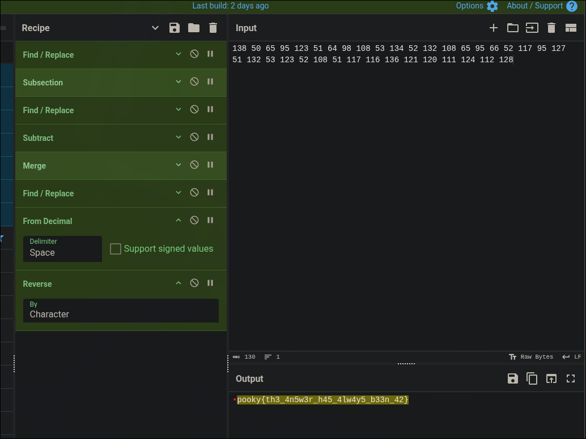

# Numerophobia

| **CTF**        | SpookyCTF |
| -------------- | --------- |
| **Category**   | Crypto    |
| **Points**     | 50        |
| **Difficulty** | Easy      |

## Statement

I went exploring the house of the crazy old man on the corner of the street. He disappeared last weekend and nobody has seen him since. Rumor has it that he was last seen walking out at midnight screaming random numbers in tongues never spoken before. I decided to go and investigate, unsurprisingly the front door was left unlocked. On the way to the stairs I almost tripped over a stack of books, one was about dyslexia I think. For some reason every other step was missing and marked with a 13 on the wall. I finally reached the top and headed towards the light at the end of the hallway. Taped on the wall was a piece of paper…

```
23 50 65 50 65 50 65 50 65 50 65 50 65 50 65 50 65 50 65 50 65 50 65 50 65 50 65 50 65 50 65 50 65 50 65 50 65 50 65 10 138 50 65 95 123 51 64 98 108 53 134 52 132 108 65 95 66 52 117 95 127 51 132 53 123 52 108 51 117 116 136 121 120 111 124 112 128 10 63 52 63 52 63 52 63 52 63 52 63 52 63 52 63 52 63 52 63 52 63 52 63 52 63 52 63 52 63 52 63 52 63 52 63 52
```

## Overview

The challenge only gives a long list of numbers. The number `10` appears twice and splits it in three blocks: the first and the last one are made of a repeated pair of numbers, and the one in the middle has the message.

## Solution

### Read the hints in the statement

Almost every sentence of the story describes one step of the encoding:

| Sentence                                                  | Meaning                                              |
| --------------------------------------------------------- | ---------------------------------------------------- |
| "screaming random numbers"                                | The data are decimal numbers (ASCII codes)           |
| "one was about dyslexia"                                  | The text is written backwards, so it has to be reversed |
| "every other step was missing and marked with a 13"       | Every other number is shifted by 13                  |

### Remove the padding

The first block is `23` followed by `50 65` repeated, and the last one is `63 52` repeated. They are just padding, so the message is the block in the middle (between the two `10`):

```
138 50 65 95 123 51 64 98 108 53 134 52 132 108 65 95 66 52 117 95 127 51 132 53 123 52 108 51 117 116 136 121 120 111 124 112 128
```

### Undo the encoding

Following the hints, for every other number (the 1st, 3rd, 5th...) subtract 13, convert to ASCII and reverse the result. With the first numbers:

| Number | After subtracting 13 (every other) | ASCII |
| ------ | ---------------------------------- | ----- |
| 138    | 125                                | `}`   |
| 50     | 50                                 | `2`   |
| 65     | 52                                 | `4`   |
| 95     | 95                                 | `_`   |
| 123    | 110                                | `n`   |

It starts with `}24_n`, which is the end of a flag read backwards.

### CyberChef recipe

CyberChef has no operation to change only every other number, so I built a recipe for it:



The operations, with the values I used:

1. `Find / Replace`: find `$`, replace with `0` (regex, global, multiline).
2. `Subsection`: section `(\d+) \d+` (case sensitive, global).
3. `Find / Replace`: find `^(\d+)$`, replace with `$1,13` (regex, global, multiline).
4. `Subtract`: delimiter `Comma`.
5. `Merge`: merge all.
6. `Find / Replace`: find `0$`, replace with nothing.
7. `From Decimal`: delimiter `Space`.
8. `Reverse`: by `Character`.

Steps 2 to 5 subtract 13 from every other number, step 7 turns the numbers into characters and step 8 reverses the text.

### Fix the first character

The output of the recipe is:

```
•pooky{th3_4n5w3r_h45_4lw4y5_b33n_42}
```

The first character shows as a red dot, a non-printable one, and the `s` is missing. It is the last number (`128`), which the recipe doesn't change, so it becomes character 128 and not `s`. Applying the same rule by hand, `128 - 13 = 115`, which is `s`.

As a curiosity, the rule also works on the whole text without removing the padding: the first and the last block decode to `2424...`, which is `42` reversed, and the middle one gives the flag.

## Flag

```
spooky{th3_4n5w3r_h45_4lw4y5_b33n_42}
```

## What I learned

- In a crypto challenge with a story, each sentence usually hides a step of the encoding (numbers, reverse, shift of 13).
- Repeated patterns are usually padding: removing them leaves only the message.
- It is worth checking the first and last characters of a result, because recipes tend to fail at the ends.
- The flag is a reference to "the answer is 42", which is also the padding of the challenge reversed.