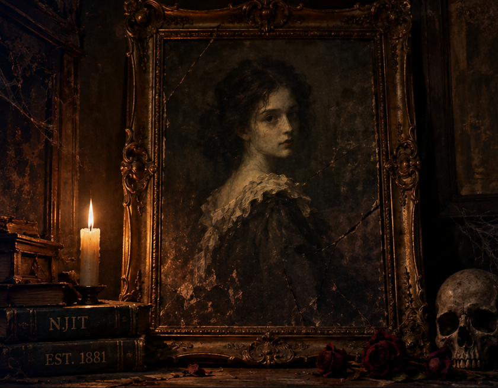
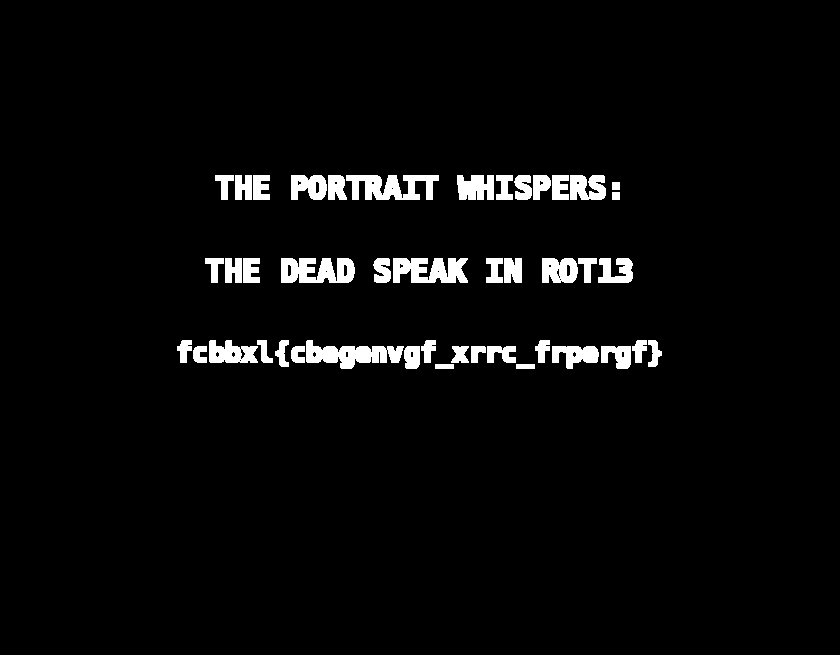

# The Haunted Portrait

| **CTF**        | SpookyCTF |
| -------------- | --------- |
| **Categoría**  | Forensics |
| **Puntos**     | 50        |
| **Dificultad** | Easy      |

## Enunciado

An old portrait was recently discovered in a storage room at NJIT just before Halloween. Students claim the painting changes when viewed at night, and some believe a secret message is hidden inside it. The university's security team examined the image but couldn't find anything unusual. Can you uncover what the portrait has been hiding all these years?

## Resumen

El reto da una única imagen PNG (`haunted_portrait.png`, 840x655, RGB): un retrato oscuro de una chica con una vela, unos libros y una calavera. A simple vista no tiene nada raro.



## Solución

### Buscar datos ocultos

El enunciado dice que hay un mensaje secreto escondido en la imagen y que seguridad "no encontró nada raro". Un PNG no tiene compresión con pérdidas, así que el sitio habitual para esconder datos es el **bit menos significativo (LSB)** de los canales de color: cambiarlo altera el valor de un píxel en 1, algo que el ojo no ve.

La imagen es muy oscura y el canal azul es el más oscuro (valor medio de unos 10, frente a 34 del rojo), así que es un buen candidato.

### Extraer el LSB del canal azul

Quedándonos solo con el último bit del canal azul de cada píxel y pintándolo en blanco o negro (`solve.py`):

```python
from PIL import Image

img = Image.open("haunted_portrait.png").convert("RGB")
blue = img.split()[2]
lsb = blue.point(lambda v: (v & 1) * 255)
lsb.save("blue_lsb.png")
```

Lo mismo se puede hacer sin código con herramientas como Stegsolve (`Blue plane 0`) o la web Aperi'Solve.

El resultado es una imagen negra con un texto en el centro:



```
THE PORTRAIT WHISPERS:
THE DEAD SPEAK IN ROT13
fcbbxl{cbegenvgf_xrrc_frpergf}
```

### Decodificar el texto

El propio texto nos dice cómo: ROT13.

```bash
echo 'fcbbxl{cbegenvgf_xrrc_frpergf}' | tr 'A-Za-z' 'N-ZA-Mn-za-m'
```

```
spooky{portraits_keep_secrets}
```

## Flag

```
spooky{portraits_keep_secrets}
```

## Lo aprendido

- En un reto de imágenes, mirar los planos de bits de cada canal (sobre todo el LSB) es una de las primeras comprobaciones.
- Un mensaje escondido en el LSB puede ser una imagen o un texto en lugar de un flujo de bits, así que ver el plano es más rápido que decodificarlo.
- La pista dentro del mensaje (`ROT13`) era una segunda capa: el texto extraído no siempre es la flag.