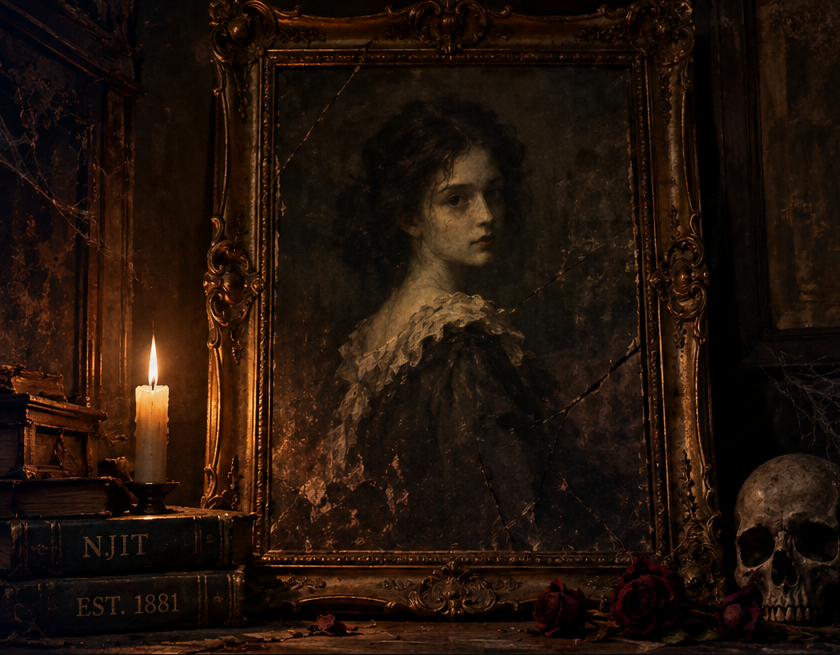
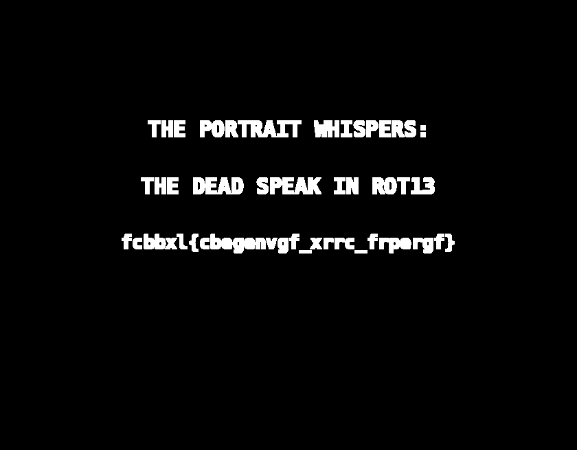

# The Haunted Portrait

| **CTF**        | SpookyCTF |
| -------------- | --------- |
| **Category**   | Forensics |
| **Points**     | 50        |
| **Difficulty** | Easy      |

## Statement

An old portrait was recently discovered in a storage room at NJIT just before Halloween. Students claim the painting changes when viewed at night, and some believe a secret message is hidden inside it. The university's security team examined the image but couldn't find anything unusual. Can you uncover what the portrait has been hiding all these years?

## Overview

The challenge gives a single PNG image (`haunted_portrait.png`, 840x655, RGB): a dark portrait of a girl with a candle, books and a skull. At first sight there is nothing unusual in it.



## Solution

### Look for hidden data

The statement says that a secret message is hidden inside the picture and that security "couldn't find anything unusual". A PNG has no lossy compression, so the usual place to hide data is the **least significant bit (LSB)** of the color channels: changing it alters the value of a pixel by 1, which the eye can't see.

The picture is very dark, and its blue channel is the darkest one (mean value around 10, against 34 for red), so it is a good candidate.

### Extract the LSB of the blue channel

Keeping only the last bit of the blue channel of every pixel and painting it as black or white (`solve.py`):

```python
from PIL import Image

img = Image.open("haunted_portrait.png").convert("RGB")
blue = img.split()[2]
lsb = blue.point(lambda v: (v & 1) * 255)
lsb.save("blue_lsb.png")
```

The same can be done without code with tools like Stegsolve (`Blue plane 0`) or the website Aperi'Solve.

The result is a black image with a text in the middle:



```
THE PORTRAIT WHISPERS:
THE DEAD SPEAK IN ROT13
fcbbxl{cbegenvgf_xrrc_frpergf}
```

### Decode the text

The text itself tells us how: ROT13.

```bash
echo 'fcbbxl{cbegenvgf_xrrc_frpergf}' | tr 'A-Za-z' 'N-ZA-Mn-za-m'
```

```
spooky{portraits_keep_secrets}
```

## Flag

```
spooky{portraits_keep_secrets}
```

## What I learned

- In an image challenge, looking at the bit planes of each channel (especially the LSB) is one of the first checks.
- A message hidden in the LSB can be a picture or text instead of a bitstream, so viewing the plane is faster than decoding it.
- The hint inside the message (`ROT13`) was a second layer: the extracted text is not always the flag.