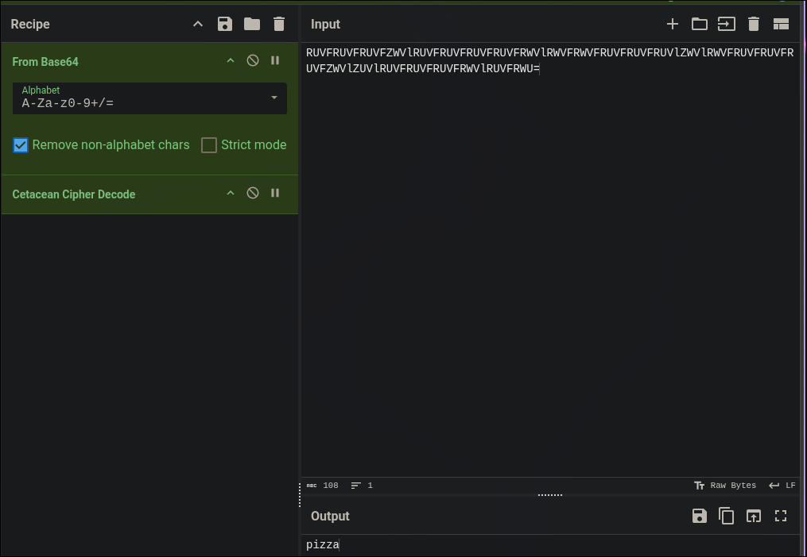
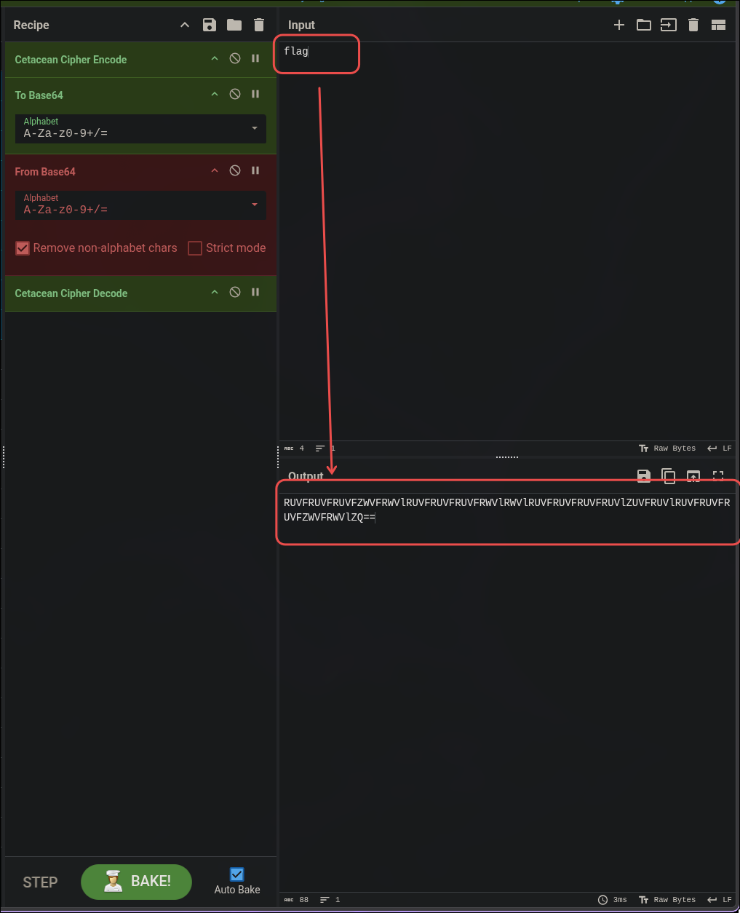
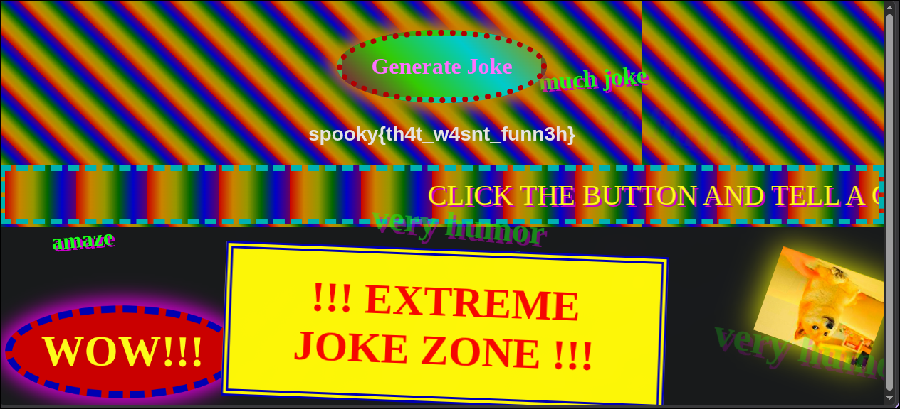

# Gelotophobia

| **CTF**        | SpookyCTF |
| -------------- | --------- |
| **Categoría**  | Misc      |
| **Puntos**     | 50        |
| **Dificultad** | Easy      |

## Enunciado

Trying to make someone laugh? Then check out this website for some awesome jokes!

_this challenge contains ... bright, flashing, strobe lights. Those who are seizure-prone / have epilepsy are advised to skip this challenge._

## Resumen

El reto es una página web con un botón "Generate Joke". Cada clic carga un chiste sobre algún tema, y la página está llena de ruido visual.


## Solución

### Mirar la URL

Al generar un chiste, la URL contiene una ruta larga que parece base64:

```
http://18.217.64.238/RUVFRUVFRUVFZWVlRUVFRUVFRUVFRUVFRWVlRWVFRWVFRUVFRUVFRUVlZWVlRWVFRUVFRUVFRUVFZWVlZUVlRUVFRUVFRUVFRWVlRUVFRWU=
```

El chiste que salió era sobre pizza, así que la ruta probablemente codifica esa palabra.

### Decodificar la ruta

Al decodificar el base64 con `Cetacean Cipher` se obtiene `pizza`, así que la ruta es simplemente el tema del chiste codificado como `Cetacean Cipher -> base64`.



### Codificar `flag` de la misma forma

En CyberChef, con `flag` como entrada, usa `Cetacean Cipher Encode` y después `To Base64`:

```
RUVFRUVFRUVFZWVFRWVlRUVFRUVFRUVFRWVlRWVlRUVFRUVFRUVFRUVlZUVFRUVlRUVFRUVFRUVFZWVFRWVlZQ==
```



Lo mismo se puede hacer con Python (`solve.py`):

```python
import base64

def encode(word):
    bits = "".join(f"{b:08b}" for b in word.encode("utf-16-be"))
    s = "".join("E" if c == "0" else "e" for c in bits)
    return base64.b64encode(s.encode()).decode()

print(encode("flag"))
```

### Hacer la petición

Se puede pedir desde el navegador o por comando:



## Flag

```
spooky{th4t_w4snt_funn3h}
```

## Lo aprendido

- Un base64 largo en una URL siempre merece la pena decodificarlo, y el resultado puede ser otra capa de codificación.
- Una cadena formada solo por dos símbolos (aquí `E` y `e`) suele apuntar a un cifrado esotérico conocido, y la "Magic" de CyberChef o una búsqueda rápida del patrón ayuda a identificarlo.
- Una vez entendida la codificación, puedes controlar la entrada codificando tu propio valor.