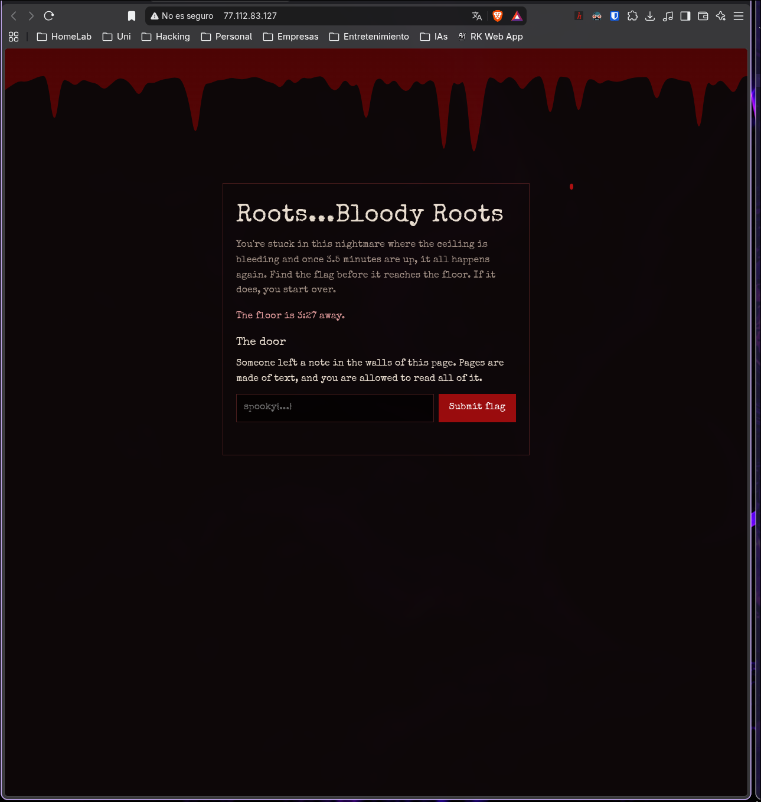
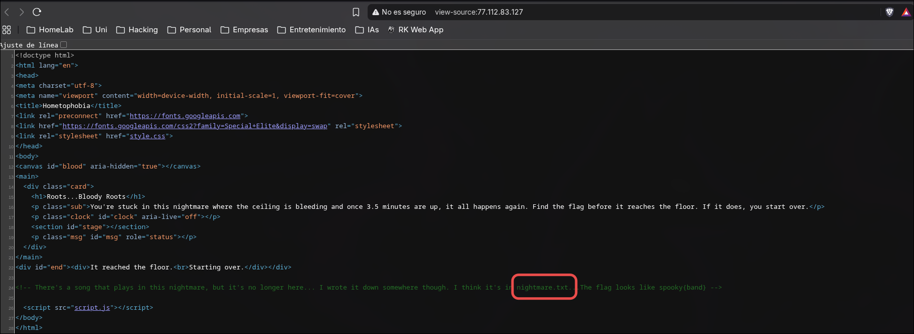
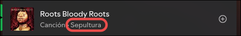

# Hemophobia

| **CTF**        | SpookyCTF |
| -------------- | --------- |
| **Categoría**  | Web       |
| **Puntos**     | 50        |
| **Dificultad** | Easy      |

## Enunciado

Estás atrapado en esta pesadilla interminable, con música y sangre que se filtra por el techo y se arrastra por las paredes. Cuando la sangre llega al suelo, tus pies quedan enraizados y la sangre te consume, y lo revives todo otra vez. Para escapar debes encontrar la llave escondida dentro de estas paredes, y solo entonces podrás salir de esta pesadilla. Buena suerte...

## Resumen

El reto es una página web con una cuenta atrás ("The floor is 3:27 away") y un formulario para enviar la flag. Según el texto, la cuenta atrás se reinicia cada 3,5 minutos, pero es solo presión y no hace falta correr. La página también dice que alguien dejó una nota en las paredes de la página y que se nos permite leerla entera.



## Solución

### Leer el código fuente

El enunciado habla de una llave escondida "dentro de estas paredes", y la página dice que "las páginas están hechas de texto y se te permite leerlo todo". Ambas cosas apuntan al código fuente HTML. Al abrirlo con `Ctrl+U` aparece un comentario HTML:

```html
<!-- There's a song that plays in this nightmare, but it's no longer here... I wrote it down somewhere though. I think it's in nightmare.txt. The flag looks like spooky{band} -->
```

Nos da dos cosas: un archivo llamado `nightmare.txt` y el formato de la flag, `spooky{band}`.



Lo mismo se puede hacer desde la terminal:

```bash
curl -s http://77.112.83.127/ | grep '<!--'
```

### Abrir nightmare.txt

Pidiendo el archivo desde la raíz del sitio:

```bash
curl http://77.112.83.127/nightmare.txt
```

```
The song from the nightmare.
I wrote the title down so I wouldn't forget it:

Roots Bloody Roots

I think this is where I heard it:

https://open.spotify.com/playlist/37i9dQZF1DWWOaP4H0w5b0?si=Ygn6SH-USsy5zhZiDgaGaQ

Who made it?
```

La nota da el título de la canción y una playlist de Spotify, y pregunta por el grupo.

### Encontrar el grupo

Al buscar la canción `Roots Bloody Roots` en Spotify se ve que es de **Sepultura**.



Como el formato de la flag es `spooky{band}`, la flag es el nombre del grupo en minúsculas.

## Flag

```
spooky{sepultura}
```

## Lo aprendido

- El código fuente de la página es lo primero que hay que mirar en un reto web: los comentarios y los archivos referenciados suelen contener el siguiente paso.
- Las pistas pueden estar a la vista de todos, en este caso en el propio texto de la página.
- La cuenta atrás solo estaba para meter presión y no afectaba a la solución.