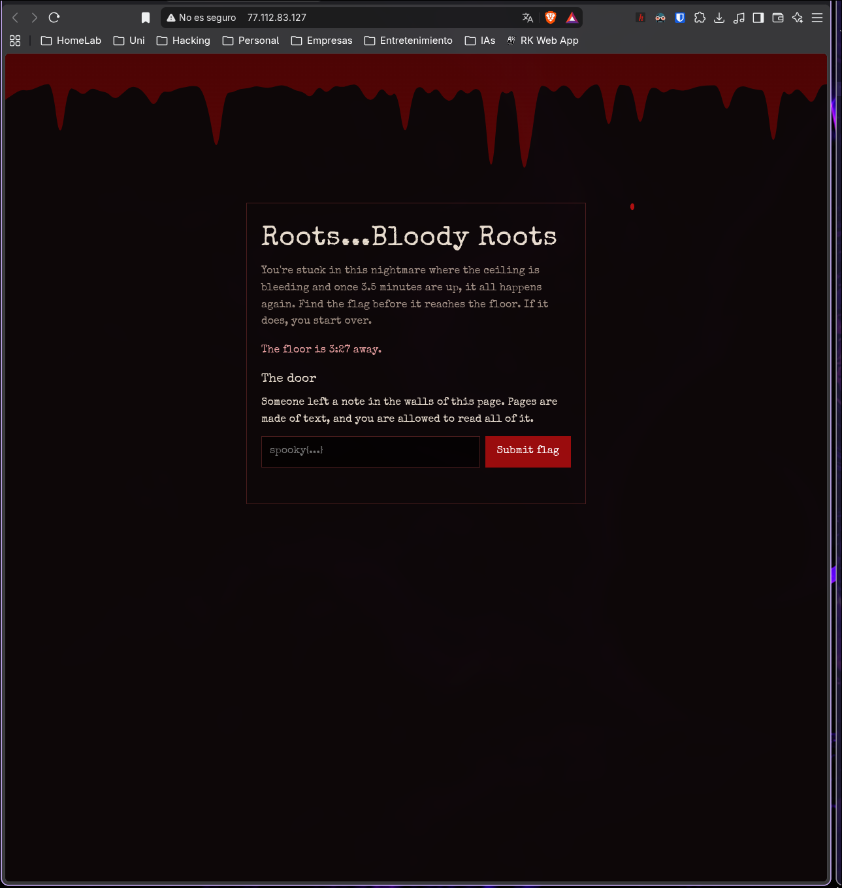
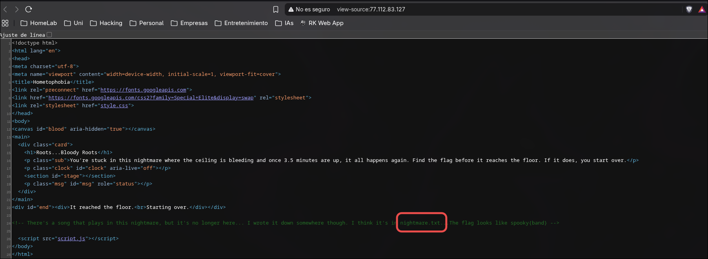
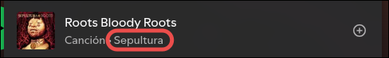

# Hemophobia

| **CTF**        | SpookyCTF |
| -------------- | --------- |
| **Category**   | Web       |
| **Points**     | 50        |
| **Difficulty** | Easy      |

## Statement

You are trapped in this endless nightmare with music and blood seeping in through the ceiling, crawling down the walls. Once the blood reaches the bottom, your feet become rooted to the ground as the blood consumes you, and you relive it all over again. To escape you must find the key hidden within these walls, and only then can you escape this nightmare. Goodluck...

## Overview

The challenge is a webpage with a countdown ("The floor is 3:27 away") and a flag submission form. According to the text, the countdown resets every 3.5 minutes, but it is just pressure and there is no need to hurry. The page also says that someone left a note in the walls of the page and that we are allowed to read all of it.



## Solution

### Read the page source

The statement talks about a key hidden "within these walls", and the page says that "pages are made of text, and you are allowed to read all of it". Both point to the HTML source. Opening it with `Ctrl+U` reveals an HTML comment:

```html
<!-- There's a song that plays in this nightmare, but it's no longer here... I wrote it down somewhere though. I think it's in nightmare.txt. The flag looks like spooky{band} -->
```

It gives us two things: a file called `nightmare.txt` and the flag format, `spooky{band}`.



The same can be done from the terminal:

```bash
curl -s http://77.112.83.127/ | grep '<!--'
```

### Open nightmare.txt

Requesting the file from the root of the site:

```bash
curl http://77.112.83.127/nightmare.txt
```

```
The song from the nightmare.
I wrote the title down so I wouldn't forget it:

Roots Bloody Roots

I think this is where I heard it:

https://open.spotify.com/playlist/37i9dQZF1DWWOaP4H0w5b0?si=Ygn6SH-USsy5zhZiDgaGaQ

Who made it?
```

The note gives the song title and a Spotify playlist, and asks for the band.

### Find the band

Searching the song `Roots Bloody Roots` on Spotify shows that it is by **Sepultura**.



Since the flag format is `spooky{band}`, the flag is the band name in lowercase.

## Flag

```
spooky{sepultura}
```

## What I learned

- The page source is the first place to look in a web challenge: comments and referenced files often contain the next step.
- Hints can be hidden in plain sight, in this case in the page text itself.
- The countdown was only there to add pressure, and it didn't affect the solution.