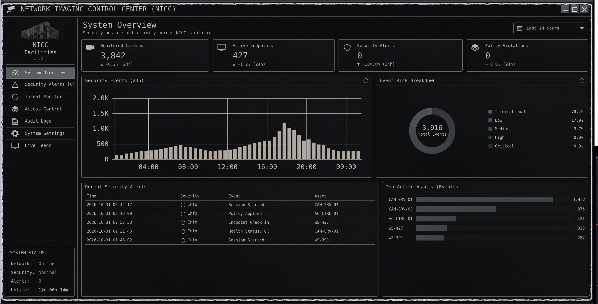
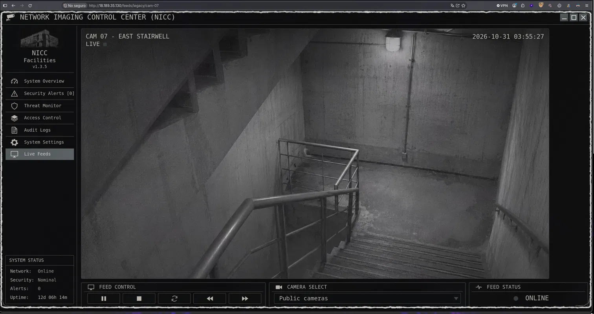
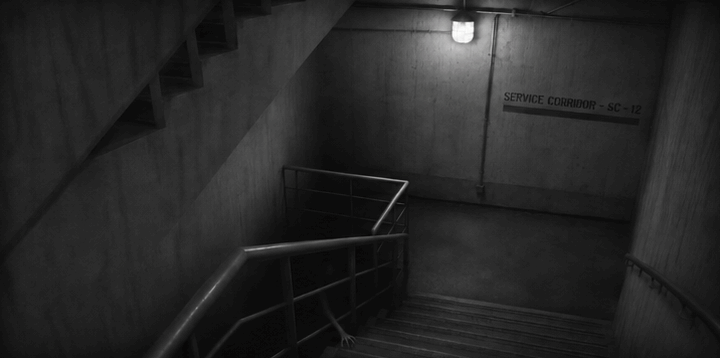
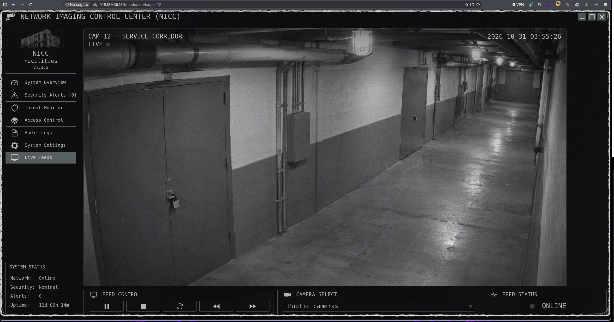
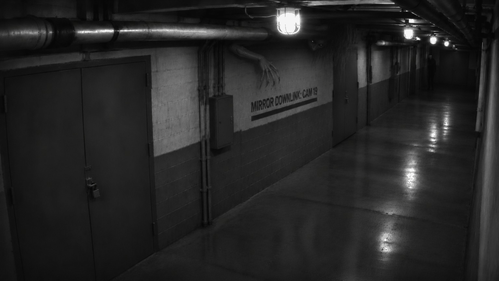
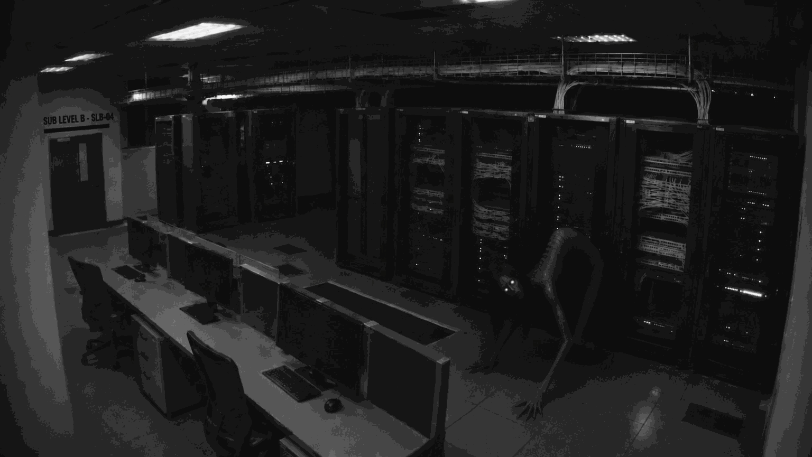
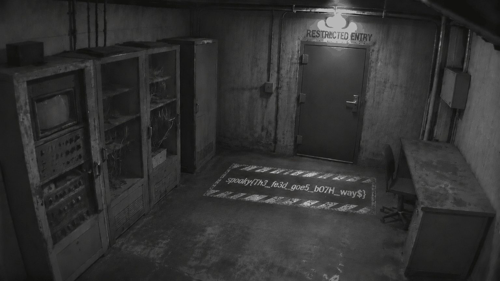

# Scopophobia

| **CTF**        | SpookyCTF |
| -------------- | --------- |
| **Categoría**  | Web       |
| **Puntos**     | 50        |
| **Dificultad** | -         |

## Enunciado

After months of unemployment, you finally land a big ol’ j-o-b in security. It’s minimum wage but hey, the experience is what matters. Though what they didn’t tell you was the physical security aspect. Analyze the dashboard and read the source to try to find what they don’t want you finding.

## Resumen

El reto es una web llamada "Network Imaging Control Center (NICC)": un panel de seguridad con métricas, gráficas y un menú. Casi todo es estático, salvo la entrada "Live Feeds", que apunta a `/feeds/active/cam-01`.



## Solución

### Leer el código fuente de la página

El enunciado dice que leamos el código fuente, así que el primer paso es mirar el HTML de la página principal. Tiene dos comentarios HTML que no aparecen en la página:

```html
<!-- TODO: Legacy camera inventory was excluded from the current monitoring migration. Confirm whether archival feeds were properly retired. -->
<!-- CAM-07 was scheduled for decommissioning but remains registered. -->
```

El enlace "Live Feeds" sigue el patrón `/feeds/<namespace>/<camera>`, así que los comentarios apuntan a una cámara olvidada:

```
http://18.189.35.130/feeds/legacy/cam-07
```



### Obtener los frames

Leyendo el código fuente de la aplicación aparece un endpoint `/frame` para cada cámara, que devuelve un GIF. Lo descargué y lo separé en frames PNG con `ffmpeg`:

```bash
curl -s http://18.189.35.130/feeds/legacy/cam-07/frame -o cam07.gif && ffmpeg -i cam07.gif cam07_frame_%02d.png
```

La pista está en el **último frame** (`cam07_frame_06.png`): un cartel en la pared que dice `SERVICE CORRIDOR - SC-12`.



### Seguir el rastro

Cada feed lleva al siguiente: el cartel del último frame da la cámara, y un comentario HTML da el directorio.

| Feed                   | Cartel en el último frame  | Comentario                                                                   | Siguiente URL          |
| ---------------------- | -------------------------- | ---------------------------------------------------------------------------- | ---------------------- |
| `/feeds/legacy/cam-07` | `SERVICE CORRIDOR - SC-12` | `Service camera directory: /feeds/service/`                                  | `/feeds/service/sc-12` |
| `/feeds/service/sc-12` | `MIRROR DOWNLINK: CAM19`   | `Redundant imaging namespace: /feeds/mirror/`                                | `/feeds/mirror/cam-19` |
| `/feeds/mirror/cam-19` | `SUB LEVEL B - SLB-04`     | `Sublevel imaging uses a three-letter directory alongside the other feeds.`  | `/feeds/sub/slb-04`    |

El segundo feed:

```
http://18.189.35.130/feeds/service/sc-12
```



```bash
curl -s http://18.189.35.130/feeds/service/sc-12/frame -o sc12.gif && ffmpeg -i sc12.gif sc12_frame_%02d.png
```

Último frame (`sc12_frame_56.png`):



El tercer feed, `cam-19`, en el directorio `mirror`:

```bash
curl -s http://18.189.35.130/feeds/mirror/cam-19/frame -o cam19.gif && ffmpeg -i cam19.gif cam19_frame_%02d.png
```

Último frame (`cam19_frame_260.png`):



El cartel dice `SLB-04` y el comentario habla de un directorio de tres letras, que es `sub`:

```bash
curl -s http://18.189.35.130/feeds/sub/slb-04/frame -o sub04.gif && ffmpeg -i sub04.gif sub_frame_%02d.png
```

### Leer la flag

El último frame del último feed (`sub_frame_123.png`) muestra la flag pintada en el suelo, delante de una puerta que dice `RESTRICTED ENTRY`.



## Flag

```
spooky{Th3_fe3d_goe5_b07H_way$}
```

## Lo aprendido

- Los comentarios HTML y el código fuente de la aplicación filtran la estructura interna de una web.
- Los recursos "legacy" olvidados que siguen registrados son un buen objetivo.
- La información solo estaba en el último frame de cada GIF, así que merece la pena separar la animación en lugar de limitarse a verla.