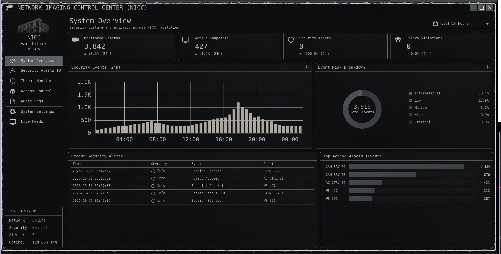
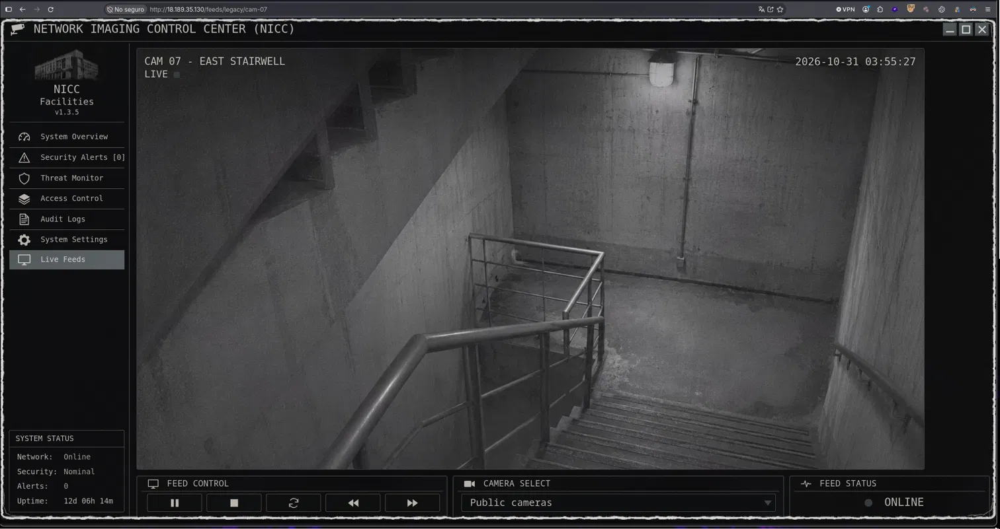
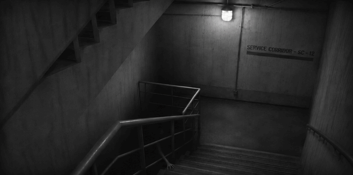
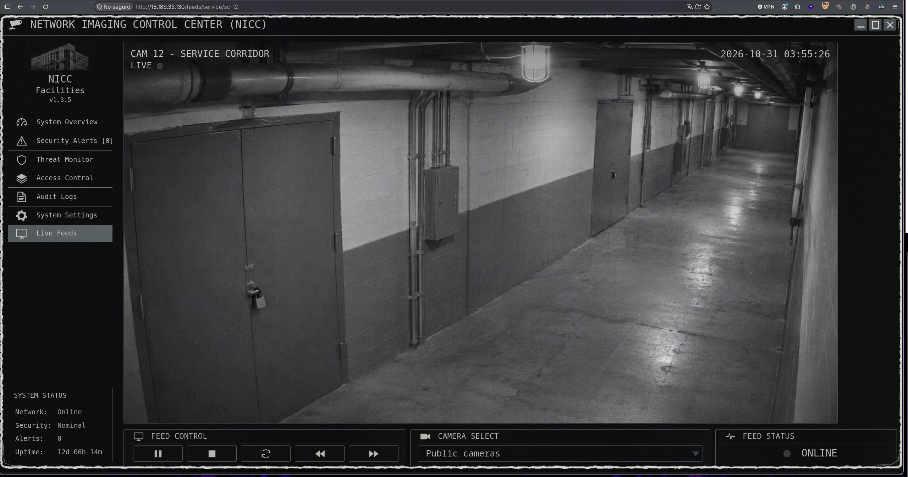
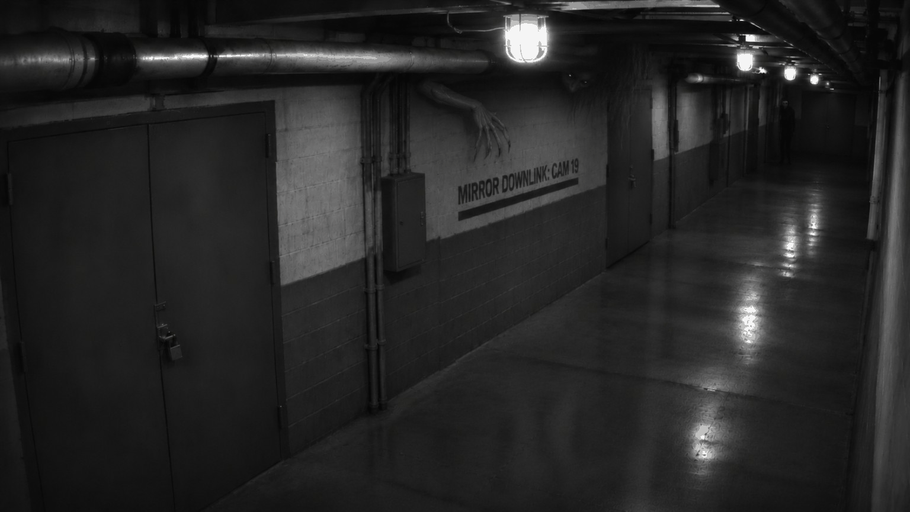
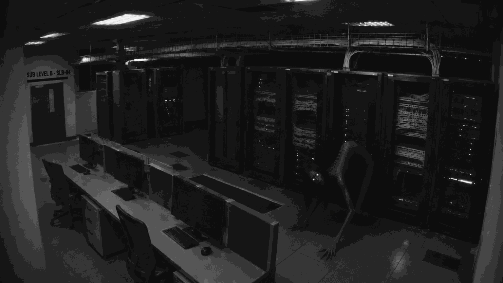
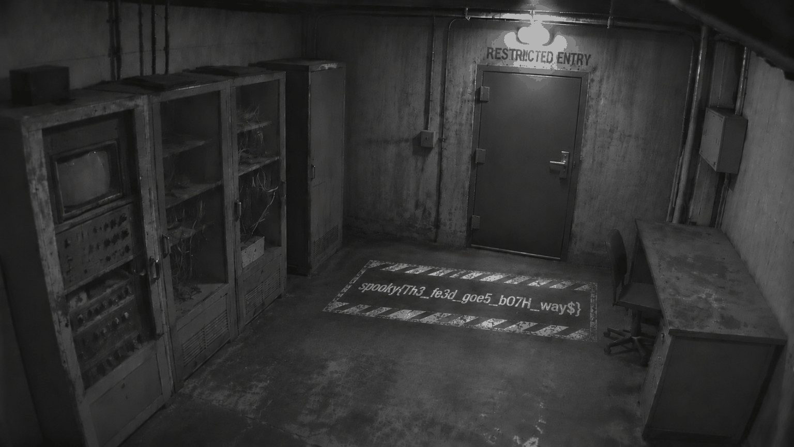

# Scopophobia

| **CTF**        | SpookyCTF |
| -------------- | --------- |
| **Category**   | Web       |
| **Points**     | 50        |
| **Difficulty** | -         |

## Statement

After months of unemployment, you finally land a big ol' j-o-b in security. It's minimum wage but hey, the experience is what matters. Though what they didn't tell you was the physical security aspect. Analyze the dashboard and read the source to try to find what they don't want you finding.

## Overview

The challenge is a website called "Network Imaging Control Center (NICC)": a security dashboard with metrics, charts and a menu. Almost everything is static, except the "Live Feeds" entry, which points to `/feeds/active/cam-01`.



## Solution

### Read the page source

The statement tells us to read the source, so the first step is to look at the HTML of the index page. It has two HTML comments that don't appear on the page:

```html
<!-- TODO: Legacy camera inventory was excluded from the current monitoring migration. Confirm whether archival feeds were properly retired. -->
<!-- CAM-07 was scheduled for decommissioning but remains registered. -->
```

The "Live Feeds" link follows the pattern `/feeds/<namespace>/<camera>`, so the comments point to a forgotten camera:

```
http://18.189.35.130/feeds/legacy/cam-07
```



### Get the frames

Reading the source code of the app shows a `/frame` endpoint for each camera, which returns a GIF. I downloaded it and split it into PNG frames with `ffmpeg`:

```bash
curl -s http://18.189.35.130/feeds/legacy/cam-07/frame -o cam07.gif && ffmpeg -i cam07.gif cam07_frame_%02d.png
```

The clue is in the **last frame** (`cam07_frame_06.png`): a sign on the wall that reads `SERVICE CORRIDOR - SC-12`.



### Follow the trail

Each feed leads to the next one: the sign in the last frame gives the camera, and an HTML comment gives the directory.

| Feed                   | Sign in the last frame     | Comment                                                                      | Next URL               |
| ---------------------- | -------------------------- | ---------------------------------------------------------------------------- | ---------------------- |
| `/feeds/legacy/cam-07` | `SERVICE CORRIDOR - SC-12` | `Service camera directory: /feeds/service/`                                  | `/feeds/service/sc-12` |
| `/feeds/service/sc-12` | `MIRROR DOWNLINK: CAM19`   | `Redundant imaging namespace: /feeds/mirror/`                                | `/feeds/mirror/cam-19` |
| `/feeds/mirror/cam-19` | `SUB LEVEL B - SLB-04`     | `Sublevel imaging uses a three-letter directory alongside the other feeds.`  | `/feeds/sub/slb-04`    |

The second feed:

```
http://18.189.35.130/feeds/service/sc-12
```



```bash
curl -s http://18.189.35.130/feeds/service/sc-12/frame -o sc12.gif && ffmpeg -i sc12.gif sc12_frame_%02d.png
```

Last frame (`sc12_frame_56.png`):



The third feed, `cam-19`, in the `mirror` directory:

```bash
curl -s http://18.189.35.130/feeds/mirror/cam-19/frame -o cam19.gif && ffmpeg -i cam19.gif cam19_frame_%02d.png
```

Last frame (`cam19_frame_260.png`):



The sign says `SLB-04` and the comment mentions a three-letter directory, which is `sub`:

```bash
curl -s http://18.189.35.130/feeds/sub/slb-04/frame -o sub04.gif && ffmpeg -i sub04.gif sub_frame_%02d.png
```

### Read the flag

The last frame of the last feed (`sub_frame_123.png`) shows the flag painted on the floor, in front of a door that says `RESTRICTED ENTRY`.



## Flag

```
spooky{Th3_fe3d_goe5_b07H_way$}
```

## What I learned

- HTML comments and the source code of the app leak the internal structure of a site.
- Forgotten "legacy" resources that remain registered are a good target.
- The information was only in the last frame of each GIF, so it's worth splitting the animation instead of just watching it.