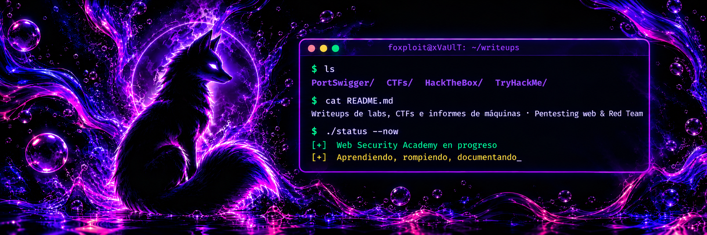

  

  
  
  
  
  
  
  

 Este README está en español. <a href="./README.md">English version available here</a>. 

## Descripción

Repositorio personal donde documento mi práctica en seguridad web y pentesting. Cada writeup recoge la o las vulnerabilidades, el proceso de explotación y la mitigación recomendada.

## Alcance

- **PortSwigger Web Security Academy**: notas de razonamiento y técnicas usadas en cada lab, sin soluciones completas.
- **CTFs**: retos y competiciones, centrados en la metodología y no solo en la flag.
- **HackTheBox**: informes de máquinas retiradas, redactados con formato de informe de pentest profesional.
- **TryHackMe**: rooms y walkthroughs.

## Contenido

| Sección                                        | Descripción                               | Estado      |
| ---------------------------------------------- | ----------------------------------------- | ----------- |
| [PortSwigger](./PortSwigger/PortSwigger.es.md) | Labs de Web Security Academy              | En progreso |
| [CTFs](./CTFs)                                 | Retos y competiciones                     | En progreso |
| [PicoCTF](./PicoCTF)                           | Retos de PicoCTF (CyLab Security Academy) | In Progress |
| [HackTheBox](./HackTheBox)                     | Informes de máquinas retiradas            | Planificado |
| [TryHackMe](./TryHackMe)                       | Rooms y walkthroughs                      | Planificado |

## Estructura de los writeups

1. **Objetivo**: qué se busca conseguir.
2. **Reconocimiento**: qué se observa y cómo.
3. **Explotación**: pasos y payloads genéricos.
4. **Mitigación**: por qué funciona y cómo prevenirlo.

## Aviso legal

Este contenido tiene fines exclusivamente educativos. Todas las técnicas se han realizado en entornos autorizados (labs, CTFs y máquinas retiradas). No las utilices contra sistemas sin permiso expreso.
