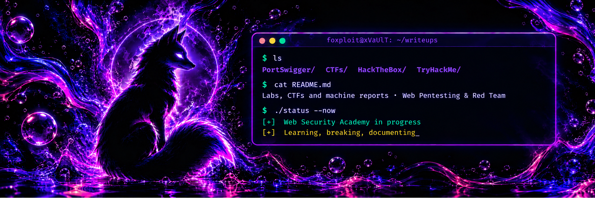

  

  
  
  
  
  
  
  
  

 This README is in English. <a href="./README.es.md">Versión en español disponible aquí</a>. 

## Descripción

Repositorio personal donde documento mi práctica en seguridad web y pentesting. Cada writeup recoge la o las vulnerabilidades, el proceso de explotación y la mitigación recomendada.

## Alcance

- **PortSwigger Web Security Academy**: soluciones de labs con payloads utilizados y el razonamiento detrás de cada uno.
- **CTFs**: retos y competiciones, centrados en la metodología y no solo la flag.
- **HackTheBox**: informes de máquinas retiradas, redactados con formato de informe de pentest profesional.
- **TryHackMe**: rooms y WalkThroughs.

## Contenido

| Sección                      | Descripción                    | Estado      |
| ---------------------------- | ------------------------------ | ----------- |
| [PortSwigger](./PortSwigger) | Labs de Web Security Academy   | En progreso |
| [CTFs](./CTFs)               | Retos y competiciones          | En progreso |
| [HackTheBox](./HackTheBox)   | Informes de máquinas retiradas | Planificado |
| [TryHackMe](./TryHackMe)     | Rooms y walkthroughs           | Planificado |

## Estructura de los writeups

1. **Objetivos**: qué se busca conseguir.
2. **Reconocimiento**: qué se observa y como.
3. **Explotación**: pasos y payloads.
4. **Mitigación**: por qué funciona y cómo prevenirlo.

## Aviso legal

Este contenido tiene fines exclusivamente educativos. Todas las técnicas se han realizado en entornos autorizados (labs, CTFs y máquinas retiradas). No las utilices contra sistemas sin permiso expreso.

