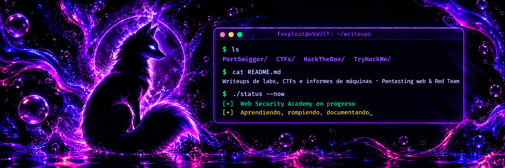

  

  
  
  
  
  
  
  
  

 This README is in English. <a href="./README.es.md">Versión en español disponible aquí</a>. 

## About

Personal repository documenting my practice in web security and penetration testing. Each writeup covers the vulnerability, the explotaitation process and the recommended mitigation.

## Scope

- **PortSwigger Web Security Academy**: lab solutions with the payloads used and the reasoning behind them.
- **CTFs**: challenges and competitions, focused on methodology rather tan just the flag.
- **HackTheBox**: reports on retired machines, written in a professional pentest report format.
- **TryHackMe**: rooms and WalkThroughs.

## Content

| Section                      | Description                 | Status      |
| ---------------------------- | --------------------------- | ----------- |
| [PortSwigger](./PortSwigger/PortSwigger.md) | Web Security Academy labs   | In Progress |
| [CTFs](./CTFs)               | Challenges and competitions | In Progress |
| [HackTheBox](./HackTheBox)   | Retired machine reports     | Planned     |
| [TryHackMe](./TryHackMe)     | Rooms and walkthroughs      | Planned     |

## Writeup structure

1. **Objective**: what needs to be achieved.
2. **Reconnaissance**: what is observed and how.
3. **Exploitation**: steps and payloads.
4. **Mitigation**: why it works and how to prevent it.

## Disclaimer

This content is for educational purposes only. All techniques were performed in authorized environments (labs, CTFs and retired machines). Do not use them against systems without explicit permission.

